# Javis · AI interview coach

Prepare for one specific job interview, then sit a live **voice mock interview** with Javis, an AI interviewer who listens, follows up on what you said, and scores both your answers and your delivery.

<p align="center">
  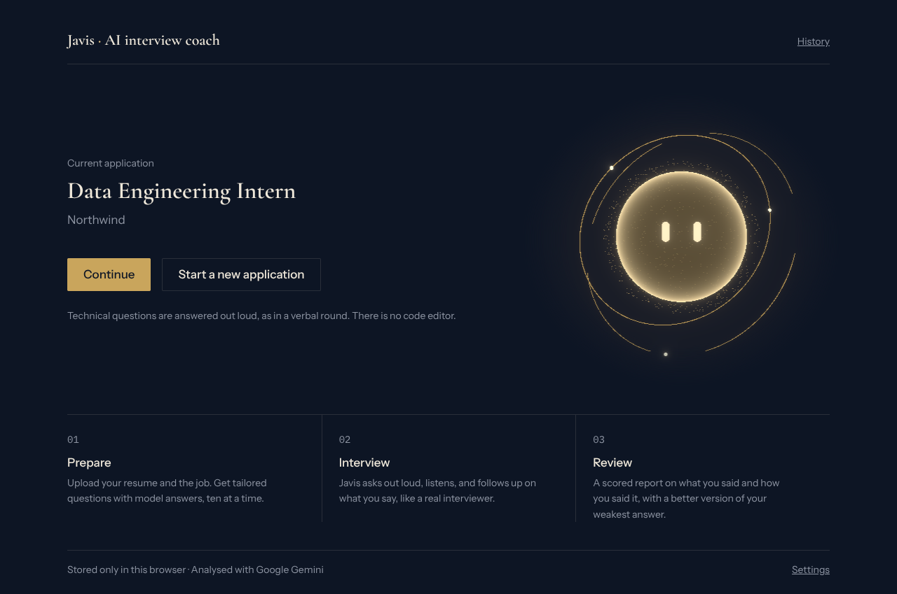
</p>

> The screenshots in this README use made-up sample data (a fictional candidate and company). Nothing in them is a real resume or employer.

## What it does

1. **Upload and analyse.** Add your resume (PDF or a photo) and the job (a link, or a screenshot of the posting). Javis builds a profile: your strengths, what the role needs, and the gaps to prepare for.
2. **Generate questions.** Tailored questions come in batches, each with key points, a model answer and tips. Short questions and scenario questions are mixed, and the classics (*Tell me about yourself*, *Why this company?*) come first.
3. **Interview out loud.** Javis speaks, listens and follows up in a video-call style screen. He greets you by name, asks questions in a realistic order, and may add a surprise question.
4. **Get a scored report.** Every answer is scored on five criteria, your delivery is scored from the camera and your speech, and you get a better version of your weakest answer.

## Screenshots

### Prepare

| Start a new application | Your profile against the role |
| :--- | :--- |
| 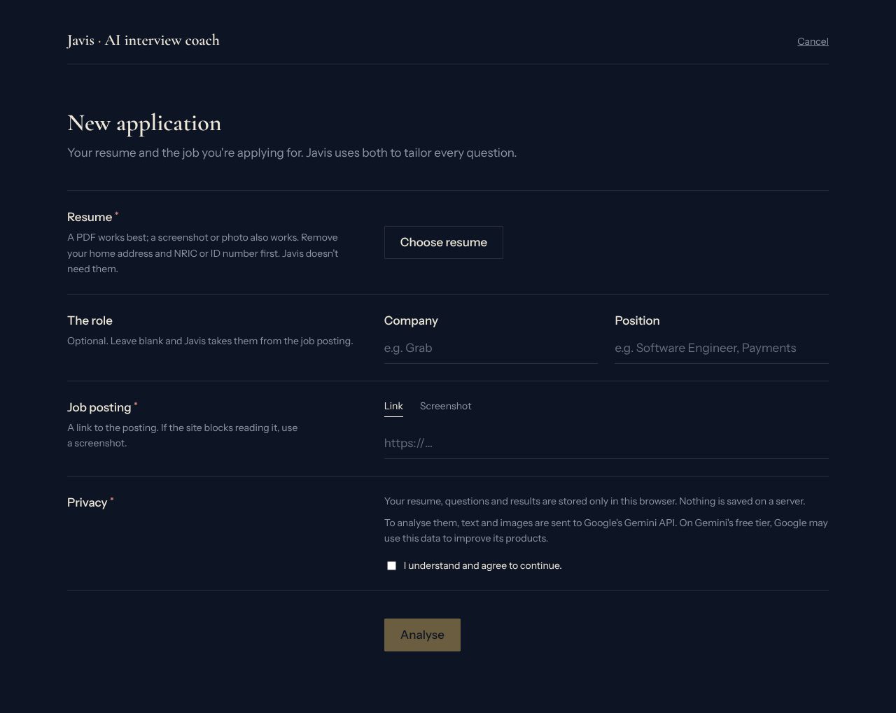 | 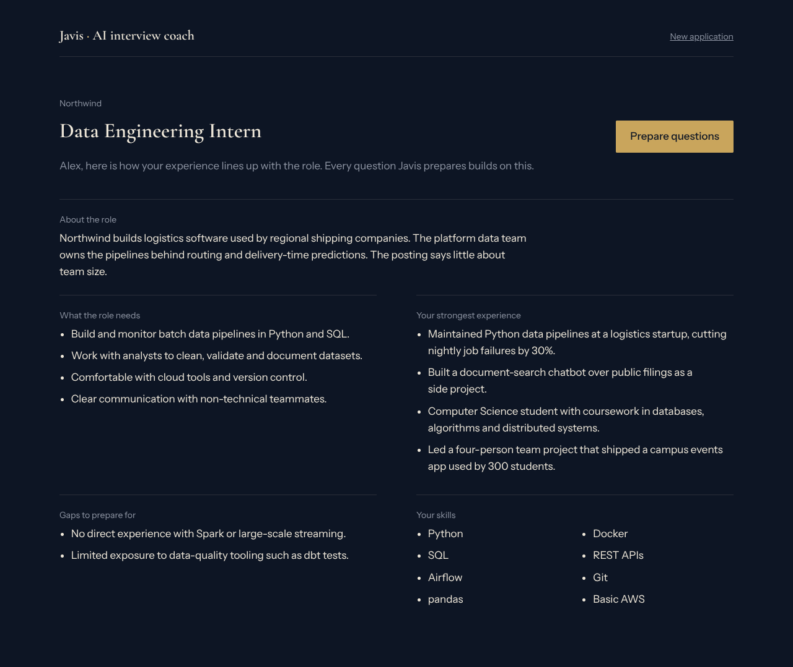 |

### Practise

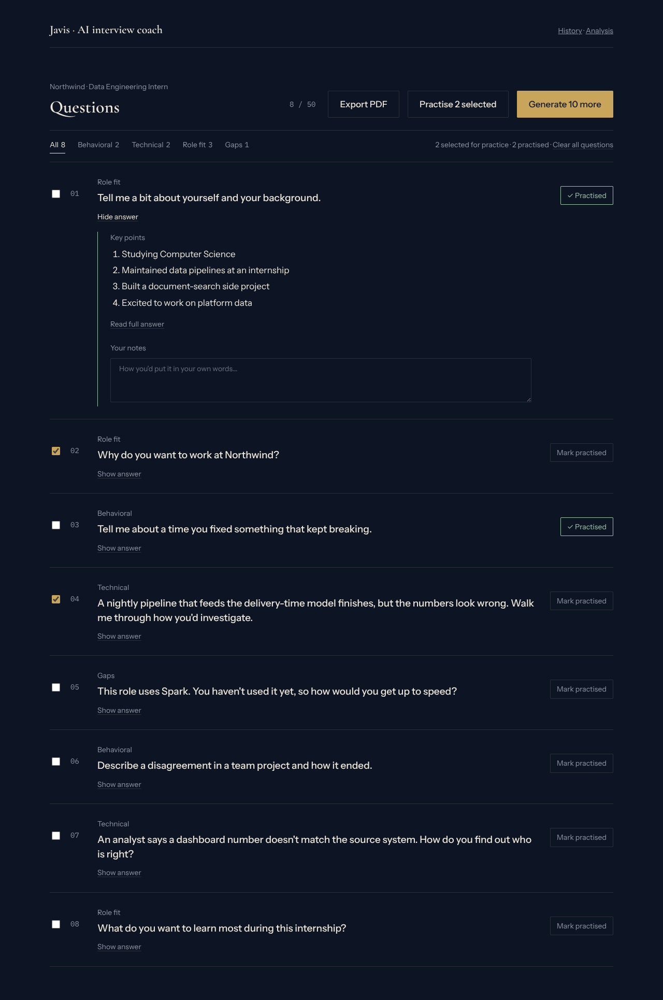

Questions stream in as they are written. You can filter by type, tick the ones to practise, read the key points or the full model answer, keep notes, mark questions as practised, and export the list as a PDF.

| Interview setup | In the interview |
| :--- | :--- |
| 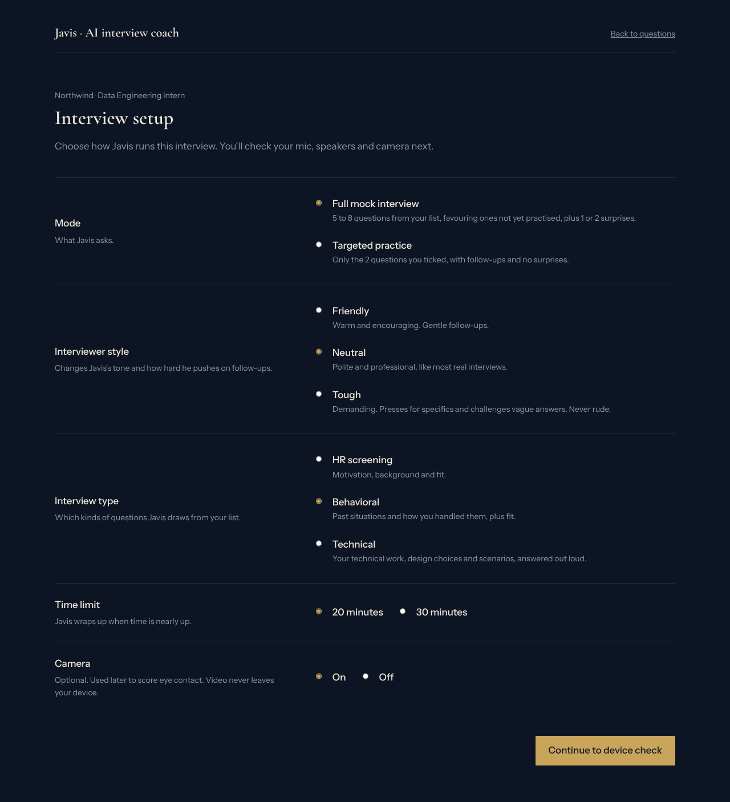 | 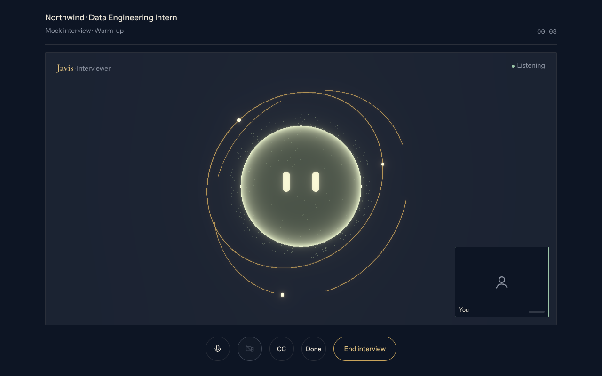 |

Choose a full mock interview or targeted practice, the interviewer's style (friendly, neutral or tough), the interview type, a time limit and whether the camera is on. In the call, Javis's AI core glows with his voice, his eyes follow you, and your self-view shows a sage border while you answer.

### Review

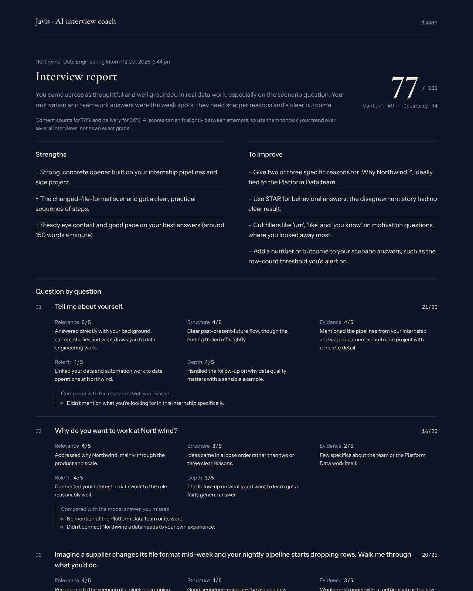

The report shows an overall score (70% answer content, 30% delivery), strengths and improvements, a question-by-question breakdown with what you missed compared with the model answer, an eye-contact chart, and a replay of the transcript.

| History | Settings |
| :--- | :--- |
| 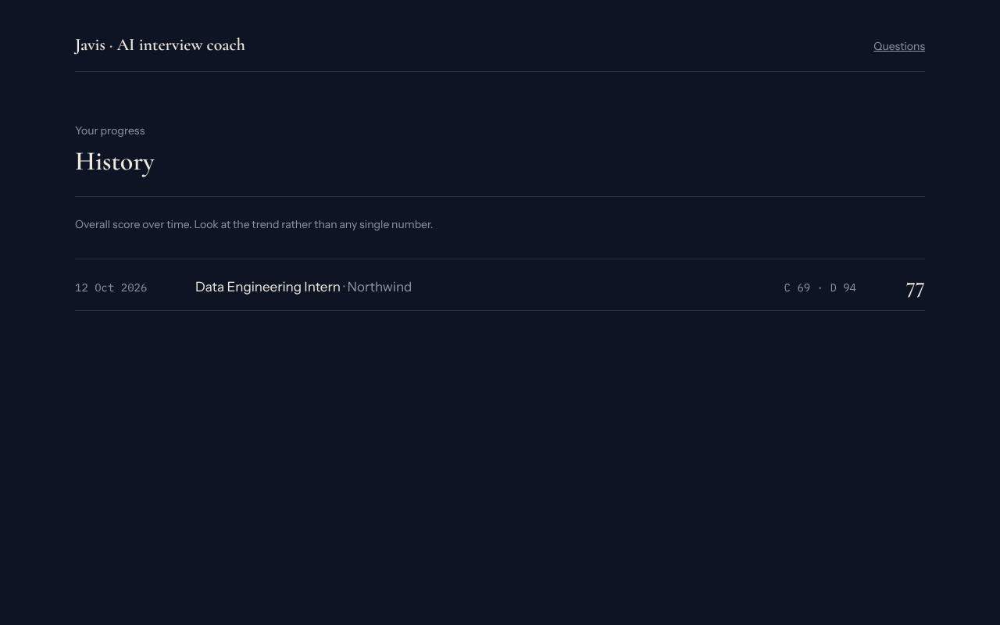 | 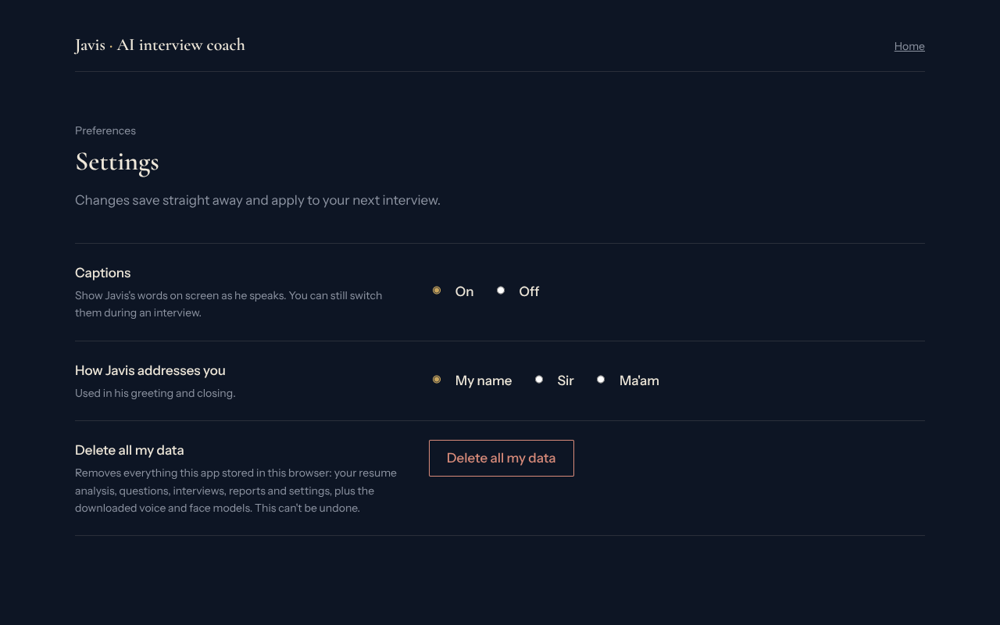 |

### On a phone

<table>
  <tr>
    <td>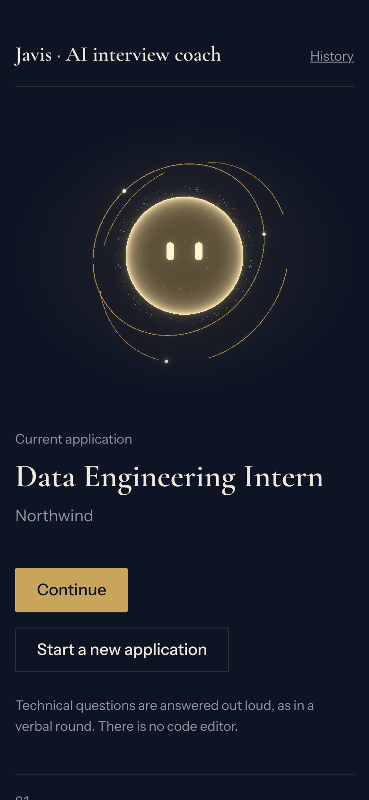</td>
    <td>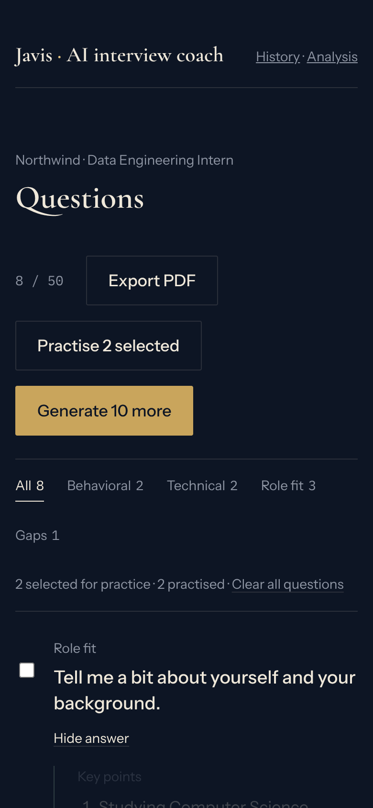</td>
    <td>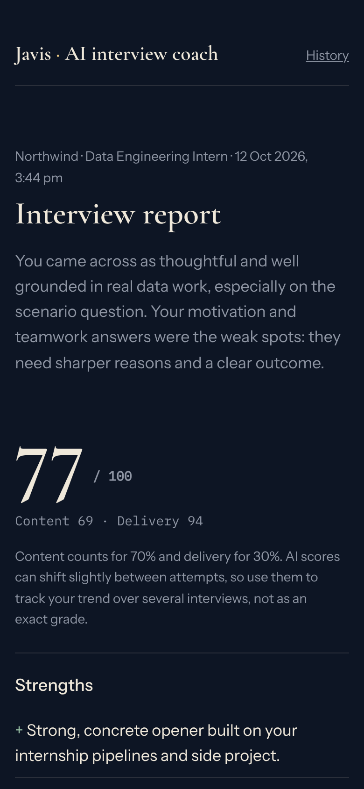</td>
  </tr>
</table>

## How the interview works

- **Voice.** Javis speaks with [Kokoro](https://github.com/hexgrad/kokoro) text-to-speech running in your browser (about 90 MB on first use, then cached). It runs in a Web Worker so the page never freezes.
- **Listening.** Chrome uses its built-in speech recognition. Safari records your answer and sends it to the AI together with the interviewer prompt. The end of an answer is detected from silence, and you can press **Done** or interrupt him.
- **Follow-ups.** After each answer Javis decides whether to follow up, comment and move on, repeat the question, pause, or wrap up, in the style you chose.
- **Delivery.** Face tracking runs in your browser with MediaPipe (video never leaves your device). It measures eye contact, look-aways, steadiness and engagement. Your speech gives pace, filler words and answer length.
- **Scoring.** Each answer is scored 1–5 on relevance, structure, evidence, role fit and depth. Delivery is scored separately, and the two combine into the overall score.

## Tech stack

| Area | Choice |
| :--- | :--- |
| App | Next.js 16 (App Router, JavaScript), React 19 |
| AI | Google Gemini through `@google/genai`, with structured JSON output and streaming |
| AI backup | Groq (optional): used only when every Gemini model is busy or out of quota |
| Voice | Kokoro TTS in a Web Worker, with a light "AI" effect chain |
| Face tracking | MediaPipe Tasks Vision (face landmarks and blendshapes) |
| AI core | three.js with `@react-three/fiber` and bloom post-processing |
| Documents | `pdfjs-dist` reads resume PDFs in the browser |
| Storage | `localStorage` only: no database, no accounts |
| Hosting | Vercel |

**Model chain.** Quick tasks (analysis, questions, the live interviewer) try Gemini Flash-Lite first, then Flash. The final report uses Pro, then Flash, then Flash-Lite. Rate limits, overload and timeouts move the request to the next model, and Groq (if configured) is the last resort.

## Run it locally

You need Node.js 20.9 or newer and a free [Gemini API key](https://aistudio.google.com/apikey).

```bash
git clone https://github.com/Shaunnnn/javis.git
cd javis
npm install
cp .env.example .env.local     # then paste your key into .env.local
npm run dev                    # http://localhost:3000
```

`.env.local` (never commit this file; it is already in `.gitignore`):

| Variable | Required | Purpose |
| :--- | :--- | :--- |
| `GEMINI_API_KEY` | yes | Your Gemini key. It stays on the server and is never sent to the browser. |
| `GROQ_API_KEY` | no | Backup AI provider ([get a key](https://console.groq.com/keys)). |
| `FORCE_GROQ` | no | Set to `1` to skip Gemini and test Groq on its own. Local testing only. |
| `SHOW_LABS` | no | Set to `1` to show the hidden test pages: `/voice-lab`, `/core-lab`, `/delivery-lab` and `/sample`. |

### Deploy on Vercel

Import the repo, add `GEMINI_API_KEY` (and optionally `GROQ_API_KEY`) under **Settings → Environment Variables**, then deploy. Redeploy after changing a variable. Anyone who deploys their own copy uses their own key and quota.

## Privacy

- Your resume, questions, interviews and reports are stored **only in your browser** (`localStorage`). Nothing is saved on a server.
- To analyse your documents and run the interviewer, text, images and short audio clips are sent to the Gemini API (and to Groq if the backup is used). On Gemini's free tier, Google may use this data to improve its products.
- Camera video never leaves your device. Face tracking and the voice model run in the browser.
- **Settings → Delete all my data** wipes everything the app stored, including the cached voice and face models.

## Browser notes

- The voice model needs a modern browser with WebAssembly. Pages are served with cross-origin isolation headers (`COOP` and `COEP`), which lets it use several CPU cores and run several times faster.
- Chrome is the smoothest for listening. Safari works but the first reply to each answer takes a little longer, because the audio is sent along with the request.
- On slow devices, Javis builds each reply in one piece before speaking so there are no pauses mid-reply. The wait before he speaks is a little longer.

## Where things live

```
app/                 pages: home, new, application, questions, interview (setup, check, call), report, history, settings
app/api/llm          the one route every AI call goes through (the browser never sends raw prompts)
app/api/fetch-job    reads a job posting from a link, with safety checks
prompts/             every prompt, one file each. Edit these to tune Javis
lib/llm.js           model chain, fallbacks, timeouts (Gemini)
lib/groq.js          the optional Groq backup
lib/schemas.js       the exact JSON shape each prompt must return
lib/client/          browser code: voice, listening, face tracking, scoring, storage
components/          shared UI, including the 3D AI core
app/theme.css        colours, fonts and spacing
```

Prompts treat everything uploaded (resume, job text, screenshots, spoken answers) as data, never as instructions.

## Roadmap

The **Javis upgrade plan**:

- [x] Backup AI provider (Groq) when Gemini is busy
- [ ] Optional: paid Gemini with a spending cap
- [ ] Phone portrait layout (mostly done; interview end and report still being checked)
- [ ] Several applications, each with its own questions and history
- [ ] Drill your weakest answers, with before and after scores
- [ ] Model-answer comparison: key points covered and missed, per answer
- [ ] Harder modes: a tougher interviewer and a 5-minute warm-up
- [ ] Female interviewer option
- [ ] Export the report as a PDF
- [ ] Coding round with a shared editor
- [ ] Demo video on the home page
